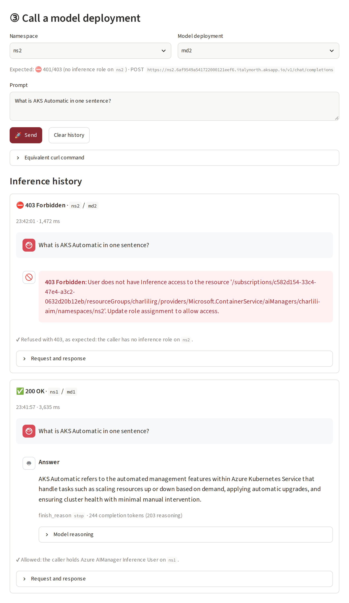

# AIManager namespace-scoped Inference RBAC demo

Shows that Azure RBAC on an AIManager **namespace** controls who can call its inference endpoint: the
account you signed in with (`az login`) holds **Azure AIManager Inference User** on `ns1` only, so the same
Entra token gets an answer from `ns1/md1` and is refused with **403** (401 for an invalid token) by `ns2/md2`.

```text
AIManager charlili-aim (italynorth, resource group charlilirg)
├── namespace ns1 ── model deployment md1   your az login account: Azure AIManager Inference User
└── namespace ns2 ── model deployment md2   your az login account: no inference role
```

Both model deployments serve `google/gemma-4-E4B-it` on `Standard_ND96amsr_A100_v4`. The steps follow the
[AIManager Partner Team Preview Testing Guide](https://msazure.visualstudio.com/CloudNativeCompute/_wiki/wikis/CloudNativeCompute.wiki/1134231/External-AIManager-Partner-Team-Preview-Testing-Guide)
(Azure RBAC inference: section 6, option 2).

> [!WARNING]
> Each `Standard_ND96amsr_A100_v4` replica costs about **$41/hour** in Italy North
> (`az aimanager model calculate-cost`), so the demo runs at about **$82/hour**. Run `scripts/cleanup.sh` when done.

## Prerequisites

- Azure CLI, jq and curl, signed in with `az login` as the account that should get access (a user or a
  service principal).
- Owner or User Access Administrator on the subscription you run it in (to create role assignments).
- Feature `Microsoft.ContainerService/AIManagerPreview` registered (it needs manual approval; see the guide).
- Python 3.10+ for the Streamlit client.

`setup.sh` installs or upgrades the `aimanager` CLI extension when needed.

## Run the demo

```bash
az login                                                  # the signed-in account is the demo user
az account set -s c582d154-33c4-47e4-a3c2-0632d20b12eb   # the scripts use the Azure CLI's default subscription

./scripts/setup.sh --dry-run   # read-only checks, plus the commands that would change Azure
./scripts/setup.sh             # asks before creating the GPU model deployments (--yes to skip)
./scripts/verify.sh            # curl check: ns1/md1 -> 200, ns2/md2 -> 401/403

python3 -m venv .venv && .venv/bin/pip install -r client/requirements.txt
.venv/bin/streamlit run client/app.py

./scripts/cleanup.sh           # deletes md1/md2, ns1/ns2 and the AIManager (add --delete-resource-group to drop charlilirg)
```

`setup.sh` is safe to re-run; it keeps resources that already exist. It:

1. Checks the subscription, the `az login` account and its object ID, feature registration, CLI extension, the
   model in the `italynorth` catalog, and that `Standard_ND96amsr_A100_v4` is a feasible plan for it (quota included).
2. Creates resource group `charlilirg`, AIManager `charlili-aim`, and namespaces `ns1` and `ns2`.
3. Assigns **Azure AIManager Inference User** to the `az login` account on the `ns1` scope, removes it from
   `ns2` if present, and uses ARM's effective-permission API to warn if an inherited or group role would
   still allow inference on `ns2`.
4. Writes `demo-config.json` (namespace endpoints and scopes, no keys) for `verify.sh` and the client.
   If the endpoints aren't available yet, it tries again once the model deployments serve.
5. Creates `md1` in `ns1` and `md2` in `ns2` (1 replica each), waits until both serve, then runs `verify.sh`.

The role is assigned before the model deployments are created on purpose. Azure RBAC changes take a few
minutes to apply, and the gateway caches authorization decisions (denials too) for about 5 minutes.

### Settings

The subscription and the account always come from the Azure CLI: the default subscription (switch it with
`az account set -s <id>`) and the signed-in account (`az login`), which is the user that gets the role.
`setup.sh` and `cleanup.sh` stop if `demo-config.json` belongs to a demo in a different subscription.

Other defaults are in [scripts/config.sh](scripts/config.sh). Override them with environment variables,
e.g. `AIM_NAME=aim-demo2 MODEL_ID=Qwen/Qwen3.5-9B ./scripts/setup.sh`.

| Variable | Default | |
|---|---|---|
| `RG` / `LOCATION` | `charlilirg` / `italynorth` | Resource group and region |
| `AIM_NAME` | `charlili-aim` | AIManager name |
| `NS1` `MD1` / `NS2` `MD2` | `ns1` `md1` / `ns2` `md2` | Namespaces and model deployments |
| `VM_SIZE` | `Standard_ND96amsr_A100_v4` | GPU VM size of both model deployments |
| `MODEL_ID` | `google/gemma-4-E4B-it` | Model, from `az aimanager model list -l italynorth` |
| `REPLICAS` | `1` | Replicas per model deployment |
| `WAIT_TIMEOUT_MIN` | `120` | How long `setup.sh` waits for the model deployments |

## Streamlit client

[client/app.py](client/app.py) signs in with Entra ID (Azure CLI or interactive browser), then shows:

1. **Who is calling**: the token's user, object ID and audience (`https://management.core.windows.net/`,
   the same token `az account get-access-token` returns, which is what the gateway accepts).
2. **What Azure RBAC says**: the role assignments that apply to the user on each namespace (direct,
   inherited or through a group) and ARM's effective-permission verdict for
   `Microsoft.ContainerService/aiManagers/namespaces/inference/action`.
3. **Call a model deployment**: pick a namespace and one of its model deployments from the dropdowns, enter
   a prompt and press **Send**. Every call goes into the inference history (newest first) with its HTTP
   status, the prompt, and either the model's answer text (for a 200, with its finish reason and completion
   token count) or the error, plus whether that was the expected outcome. A 403 reads *User does not have
   Inference access to the resource '&lt;namespace resource ID&gt;'. Update role assignment to allow access.*;
   the gateway's own response is under **Request and response**.

A run against the live deployment, after sending *What is AKS Automatic in one sentence?* to `ns1/md1` and
then to `ns2/md2` (the history lists the newest call first):



`gemma-4-E4B-it` thinks before it answers: the server returns the thinking in `message.reasoning` and the
answer in `message.content`. The app shows the answer, with the thinking collapsed under **Model reasoning**.
`max_tokens` defaults to 1024; a limit below what the thinking needs (often a few hundred tokens, even for a
one-sentence answer) cuts the answer off.

The endpoints come from `demo-config.json`. If the file is missing, **Discover endpoints from Azure** reads
them from ARM, in the Azure CLI's default subscription. Run the app from the repository root:
[.streamlit/config.toml](.streamlit/config.toml) makes it listen on localhost only, because it acts with
your Azure CLI sign-in.

To rehearse the UI without Azure resources, run it against a local mock of the gateway:

```bash
.venv/bin/python client/tests/mock_gateway.py --write-config /tmp/mock-demo-config.json &
DEMO_CONFIG=/tmp/mock-demo-config.json .venv/bin/streamlit run client/app.py
```

Tests: `.venv/bin/pip install pytest && .venv/bin/python -m pytest client/tests`

## Troubleshooting

- **`ns1/md1` returns 403.** The role assignment hasn't applied yet, or the gateway cached an earlier denial.
  Wait about 5 minutes and retry. `verify.sh` waits until ARM reports the permission before it calls `ns1`.
- **`ns2/md2` returns 200.** Another role grants the inference data action on `ns2`, for example
  *Azure AIManager RBAC Admin* on the AIManager, resource group or subscription, or through a group. Check with
  `az role assignment list --assignee-object-id <oid> --scope <ns2 scope> --include-inherited --include-groups -o table`.
  Owner, Contributor, and the *Azure AIManager Contributor* / *RBAC Reader* roles that `az aimanager create`
  grants the creator don't include it.
- **401.** The token is missing, expired, or for the wrong audience. Use `az account get-access-token`
  (audience `https://management.core.windows.net/`).
- **Namespace API keys** from `az aimanager namespace list-accesskeys` authenticate without Entra RBAC; this demo
  uses only Entra tokens.
- **`az extension show` reports `aimanager` 2.0.0b3** even after upgrading to 2.0.1b4: the package's metadata
  lags behind. `setup.sh` checks for `az aimanager namespace modeldeployment create` instead.
- **Region.** The guide uses `eastus2euap`. This demo uses `italynorth`, where the subscription has the
  AIManager model catalog and `NDAMSv4_A100` quota. If AIManager creation fails there, set `LOCATION`.
